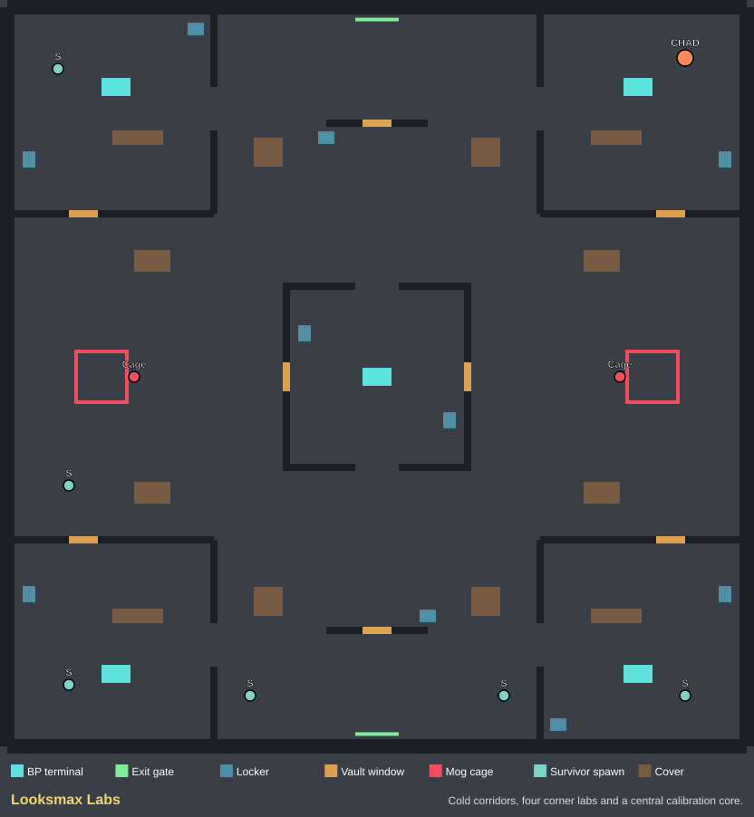
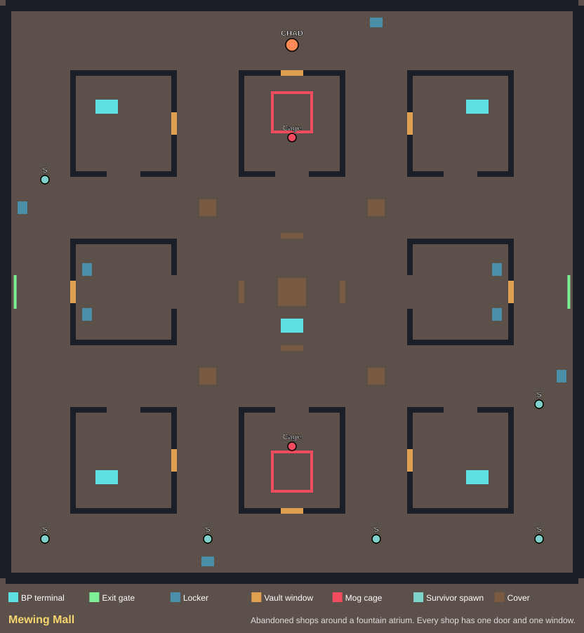

# ESCAPE THE CHAD

A Roblox multiplayer survival horror game. One randomly selected **OG Chad** hunts the survivors while they calibrate suspicious machines for entirely fictional BP, climb the ranks (LTN → MTN → HTN → Chadlite → Chad) and escape through a powered exit gate. Ranks and BP reset every round; **levels, XP, titles and wins persist**.

## Play it in Studio

1. Download `ESCAPE_THE_CHAD.zip` (or `ESCAPE_THE_CHAD.rbxlx`) and open the `.rbxlx` in Roblox Studio (**File → Open from File**).
2. In the **Test** tab choose a multiplayer test (**Clients and Servers** / **Server & Clients** / **Local Server**, depending on your Studio version) with **2 or 3 players** and start. Solo Play waits for a second player.
3. In the lobby, open the **Loadout** panel to pick your survivor ability and vote for a map. After a 15-second intermission the winning map is generated and one player becomes the OG Chad.

The map and HUD are generated when the server starts, so an empty editor viewport before Play is expected.

## How the game works

### Survivors
- **Calibrate BP terminals** (hold **E**, 2.5 s) for +25 BP. Each terminal overheats for 9 s after use, and each survivor has a 6 s cooldown, so spread out. The OG Chad gets a **ping** every time a terminal is calibrated.
- Earn extra BP by **reviving** downed teammates (+15), **healing** injured ones (+10) and **freeing** caged ones (+20).
- When the team reaches the terminal goal (`max(4, survivors × 3)`) the **exit gates power up** and the **endgame collapse** starts: at most 90 seconds remain. Survivors at **Chad rank (100 BP)** hold **E** at an exit gate to escape.
- **Health:** a hit makes you **Injured** (with a short speed burst); a second hit **Downs** you. Downed survivors crawl and pick themselves up after 45 s, or a teammate revives them.
- **Carried:** the Chad can pick up downed survivors. Mash **Space** (or the WIGGLE button) to break free.
- **Mog Cages:** carried survivors get locked in a cage. Teammates free them at the red panel. Cage timers are 40 s, then 22 s; the **third cage eliminates** you. Caged survivors get 3 lucky **Struggle** attempts.
- **Lockers:** hold **E** to hide. You peek out through the vents. The Chad can't hit you there, but **can search lockers** and grab whoever is inside.

### Movement
- **Shift** sprint (uses stamina; empty stamina means you're exhausted until it recovers), **C** slide while running, **Space** next to an orange window **vaults** through it.
- Survivors vault fast; the Chad vaults slowly and can barely jump, so windows and cover create chase loops.
- Sprinting leaves **scratch marks** that only the Chad can see.

### Abilities (Q)
| Survivor (pick one in the lobby) | Effect | Cooldown |
|---|---|---|
| Mog Dash | Burst forward | 18 s |
| Fog Machine | Smoke cloud; the Chad can't hit into or through it | 35 s |
| Jawline Flash | Blinds and stuns a nearby Chad facing you; frees a carried teammate | 40 s |
| Protein Shake | Heals you when injured; otherwise refills stamina and gives a speed burst | 45 s |

| OG Chad | Effect | Cooldown |
|---|---|---|
| Click: Attack | Short-range swing. Two hits down a survivor | 1.4 s miss / 2.6 s hit |
| Q: Gym Charge | Full-speed sprint for 2.2 s | 20 s |
| F: Mog Aura | Reveals every survivor not hiding in a locker for 4.5 s | 45 s |

### Winning
Survivors win if at least half of them escape. Otherwise the OG Chad wins: everyone was eliminated, or time ran out. If the Chad leaves, survivors win.

### Progression
Every round awards XP (calibrations, revives, heals, rescues, escapes and wins for survivors; hits, downs, cages, eliminations and wins for the Chad). Levels unlock titles from *Mewing Rookie* to *Giga Legend*. Stats are saved with DataStores, and the lobby **Top Moggers** board shows global wins.

> To save progress, publish the place and enable **Game Settings → Security → Enable Studio Access to API Services**. Without it (or for Studio test players, whose IDs are negative), the game logs one warning and keeps progress for the session only.

### Maps
| Looksmax Labs | Mewing Mall |
|---|---|
|  |  |

Regenerate these from the real map builder with `lune run tools/render_maps.luau`. Maps are plain data in `src/shared/Maps.luau`; tests check every map for reachable terminals, exits, cage panels and lockers without vaulting, sealed cages and clear spawns.

### UI
Compact match panel (role, timer, BP rank, terminal progress), team list with live status and cage timers, stamina and status banner, ability bar with cooldowns (all buttons work on touch), toast feed, role-reveal splash, lobby panel (profile, XP bar, loadout, map vote), results screen with XP and level-ups, and spectating once you're out. **H** or **Help** shows role-specific instructions; **X** hides the status panel and **HUD** brings it back.

Controls also work on gamepad: A jump/vault/wiggle, X interact, B slide, Y ability, L3 sprint toggle, L1 Mog Aura, R2 attack.

## Original chase audio — one manual asset step

`assets/audio/chase-placeholder.wav` is an original synthesized eight-second loop, supplied with its deterministic Python generator. No third-party character or music IDs are used.

1. Publish a private test experience under the intended user/group in Studio.
2. Upload the WAV using Roblox's audio asset workflow in Creator Dashboard or Studio Asset Manager. Wait for processing/moderation, then grant the experience permission to use it where required.
3. Put its ID in `src/shared/Config.luau`: `ChaseSoundId = "rbxassetid://YOUR_NUMERIC_ID"`. Rebuild or sync before starting the test.
4. Approach OG Chad as a living survivor: music fades in inside 65 studs, reaching its configured maximum near 18 studs. It fades out when distant and stops on capture, escape, death, round end, or killer departure.

The shipped ID is empty: chase visuals work immediately, but **audio is silent until your upload is configured**. If playback fails, check Studio Output and asset ownership/experience permissions. Roblox cannot play a local WAV path as a SoundId. No API keys, HTTP requests, or DataStore settings are required for this prototype.

## Tooling and script sync

Pinned versions: **Rojo 7.7.1**, **Lune 0.11.1**, in `rokit.toml`. Install [Rokit](https://github.com/rojo-rbx/rokit) on your Studio computer, then run from this repository:

```sh
rokit install
rojo build default.project.json -o escape-the-chad.rbxlx
rojo serve default.project.json
```

Install the matching [Rojo Studio plugin](https://rojo.space/docs/v7/getting-started/installation/), open a local place, and connect the plugin to the local Rojo server (default port 34872). Accept the sync for this place, then start a multiplayer test. Edit scripts in `src/`; Rojo syncs them into the DataModel. Restart the test after gameplay edits. Keep source-controlled scripts authoritative; Studio edits can be overwritten by sync.

Run Rojo **on the same computer as Studio**. The cloud machine's localhost is not your computer's localhost. You can download/copy this source project locally, or use the built place directly. No cloud port exposure is required.

### Studio MCP availability

This session exposed no Roblox/Studio MCP tools, and its runtime is Linux with no Studio process. A direct Studio connection was therefore unavailable. A built-in Studio MCP server on your computer is usable only when your AI client is configured to reach it; it is not automatically visible to this cloud session. This project uses the tested Rojo build path instead. No MCP connection or live Studio playtest is claimed.

## Development and checks

On this Linux cloud environment:

```sh
python3 tools/bootstrap.py
bash tools/check.sh
lune run tools/render_maps.luau   # optional: refresh docs/maps/*.svg
```

The bootstrap downloads pinned official release archives with TLS verification and SHA256 checks. Tools live in ignored `.tools/`. The check script stops on the first failure and writes `build/escape-the-chad.rbxlx`.

On Windows/macOS after `rokit install`, create `build/`, then run:

```sh
rojo build default.project.json -o build/escape-the-chad.rbxlx
lune run tests/rules.spec.luau
lune run tests/place.spec.luau
lune run tests/world.spec.luau
lune run tests/hud.spec.luau
```

What the automated checks cover:

- **Rules** (34 scenarios, 400 assertions): role assignment, ranks, terminal cooldown/overheat, endgame collapse, hits/injured/downed, lockers and grabs, pickup, rate-limited wiggling, cage timers and elimination, lucky escapes, revive/heal/rescue rewards, escapes, all win/lose results, disconnects, invalid timestamps, XP, levels, titles, map voting and the ability catalogue.
- **Place build:** compiles all 12 source files and checks 41 properties of the built place (scripts, modules, remotes).
- **Maps:** builds the lobby and every arena with Lune's Roblox instance model: 784 checks, including walkable routes, sealed cages, spawn clearance, prompt configuration and both sides of every vault window.
- **HUD** (68 checks): construction, help/hide/restore, viewport fitting from phone to desktop, team list, ability bar and cooldowns, toasts, loadout, map vote, profile and results.

These tests do **not** run Roblox networking, physics, character animation, UI rendering, prompt delivery, DataStores or audio. Use the Studio checklist below before calling a build playtested.

## Studio acceptance checklist

- [ ] Start 3 clients. Output has no errors. Map vote and loadout selection work in the lobby; the voted map loads.
- [ ] Role reveal shows; one OG Chad, two survivors. HUD, team list and ability bar match each role.
- [ ] Terminals: hold E for BP; the overheated screen turns red; the Chad sees a ping. A short hold, the Chad, or a too-distant player get nothing.
- [ ] Sprint drains stamina, exhaustion works, slide works, survivors vault windows quickly, the Chad vaults slowly and can't jump over sills.
- [ ] Chad attack: first hit injures (speed burst), second downs. Missing slows the Chad. Smoke blocks hits.
- [ ] Pick up a downed survivor; wiggle free; Jawline Flash frees a carried survivor and blinds the Chad.
- [ ] Cage a survivor; rescue from the panel; struggle attempts; cage timeout eliminates; third cage eliminates.
- [ ] Lockers: hide (camera peeks out), leave, the Chad searches and grabs the hider.
- [ ] Powered exits turn green; endgame timer drops to 90 s; Chad-rank survivors escape; results screen shows XP; spectating works when out.
- [ ] Disconnect the Chad mid-round (survivors win). Late joiners spectate until the next round.
- [ ] Published place with API access: level/XP/wins persist across sessions; leaderboard fills.
- [ ] Narrow/mobile viewport and touch/gamepad controls.

## Layout

```text
src/shared/Config.luau          All gameplay tuning
src/shared/Rules.luau           Pure rank/attack/XP/level/vote calculations
src/shared/RoundState.luau      Pure, server-owned round state machine
src/shared/Abilities.luau       Survivor and killer ability catalogue
src/shared/Maps.luau            Map definitions (data)
src/server/Main.server.luau     Round loop, prompts, combat, carry, abilities, voting
src/server/World.luau           Builds arenas and the lobby from map data
src/server/DataService.luau     Profiles (DataStore) and the wins leaderboard
src/client/Main.client.luau     Input, prompt filtering, HUD updates, camera, notifications
src/client/Hud.luau             All UI construction
src/client/Movement.luau        Stamina sprint, slide, vaulting, dash
src/client/Effects.luau         Chase audio, reveal, pings, flashes, scratch marks
tests/                          Rule, build, map and HUD validation
tools/                          Bootstrap, checks, map renderer, audio generator
docs/maps/                      Generated top-down map layouts
```

Clients never award BP, choose roles or decide hits. The server validates phase, role, health state, distance, line of sight, hold timing, cooldowns and rate limits before accepting any interaction or ability. Movement speed is applied by the client from server-set state; full movement anti-cheat is outside the scope of this project.
